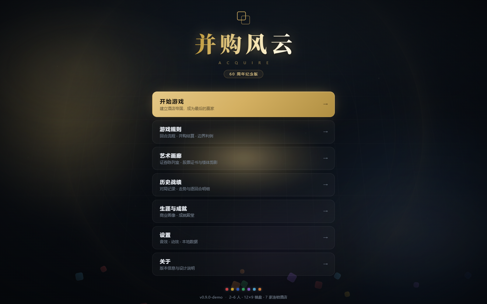
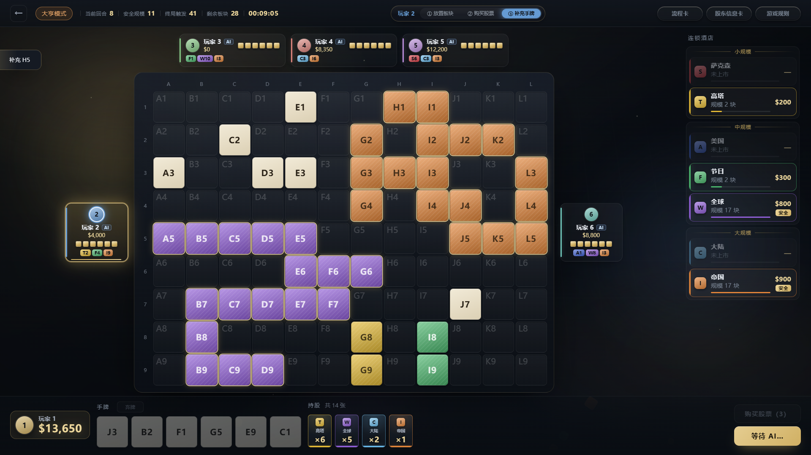
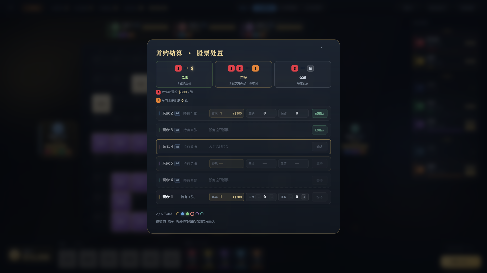
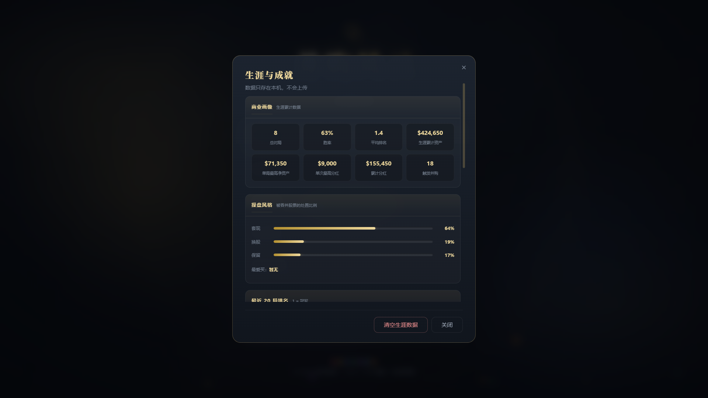

# Acquire · 60th Anniversary Edition

A zero-dependency browser implementation of the classic board game **Acquire** (60th Anniversary Edition).

Open `index.html` and play. No build step, no server, no network, no npm packages.





## Features

- **Full rules engine** — three-phase turns (place a tile → buy stock → draw), mergers with white-tile handling, ranked dividend seating, per-share stock disposal, endgame settlement
- **Classic and Tycoon modes** — dividend tables match the physical shareholder card
- **Three AI difficulty levels** — covering tile placement, stock purchases, tie-breaking and stock disposal, with memory of past failures and tile weights
- **2–6 player hot-seat** — plus a full-AI spectate mode
- **Replay frames, career stats and 30 achievements** — stored locally in the browser
- **Sound** — synthesized in real time with the Web Audio API, no audio files

## Play

1. Download or clone this repository
2. Double-click `index.html`

The interface is in Chinese. The full rulebook is available at [`规则书.md`](规则书.md) (written in Chinese).

> 零依赖的《并购风云》浏览器版（ACQUIRE 60 周年纪念版）。
> 纯 HTML / CSS / 原生 JS，双击 `index.html` 即玩，无需构建、无需服务器、无需联网。

## More screens

<table>
  <tr>
    <td></td>
    <td></td>
  </tr>
  <tr>
    <td align="center">Merger resolution</td>
    <td align="center">Career &amp; achievements</td>
  </tr>
</table>

## Structure

```
index.html          entry point
css/                stylesheets
js/                 23 modules, loaded in order via plain <script> tags
tests/              Node test files (no dependencies)
docs/images/        screenshots
规则书.md            full rulebook (Chinese)
sfx-tuner.html      standalone sound-tuning page
```

The architecture is layered:

- **Rules engine** (`js/engine.js`) — pure logic, no DOM access
- **Data layer** (`js/selectors.js`) — read-only pure functions
- **AI** (`js/ai.js`, `js/ai-memory.js`) — all decision making
- **Presentation** (`js/board.js` and view modules) — rendering and interaction

Players and AI share the same code paths — the only difference is who triggers them.

## Tests

```sh
node tests/engine.test.js
node tests/merger.test.js
node tests/selectors.test.js
```

The full suite is 9 files / 275 assertions.

## License

All rights reserved. Published for viewing and personal play.
